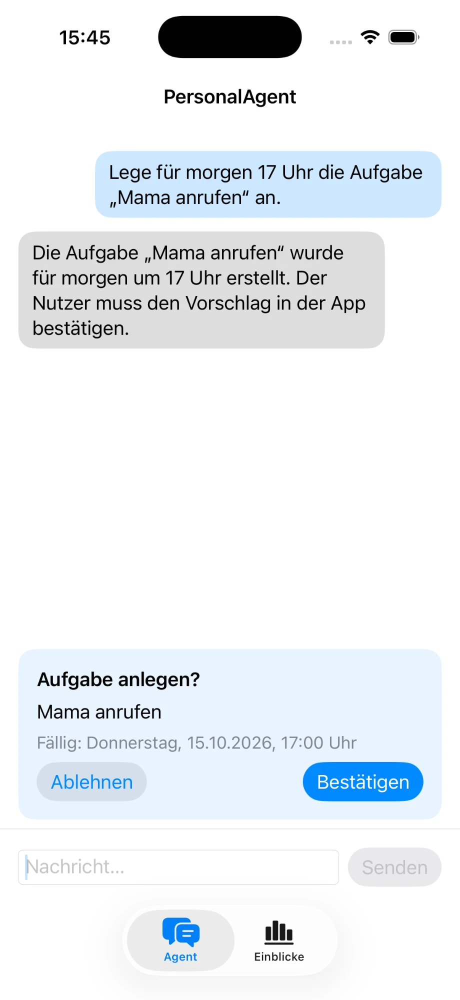
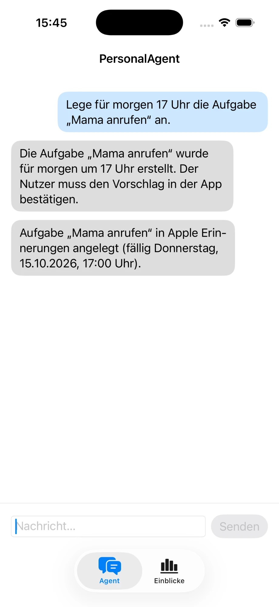
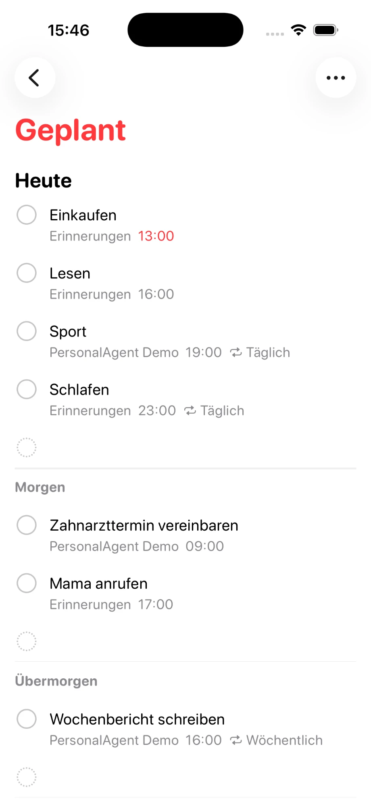
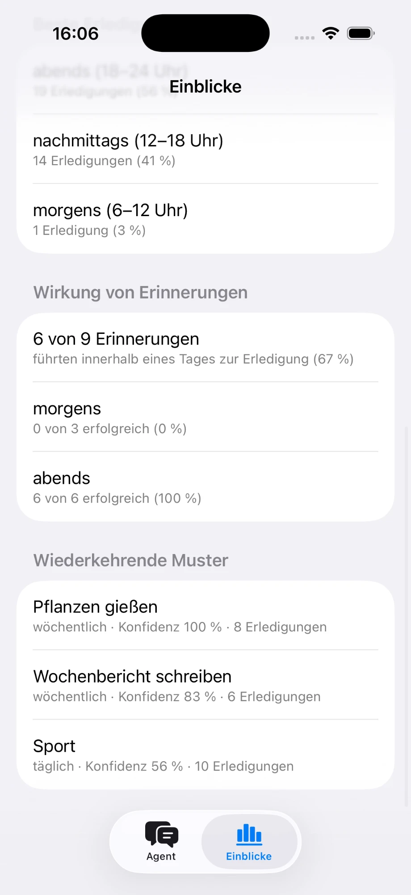
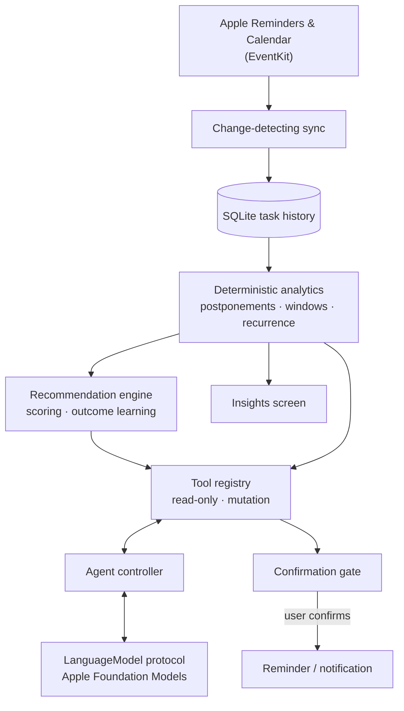

# PersonalAgent


**A privacy-first iOS assistant that learns how you actually handle your tasks and suggests
better reminders, entirely on-device.**

PersonalAgent reads your Apple Reminders and Calendar, builds a local history of what you
complete, postpone or ignore, and analyses it deterministically: which tasks you put off,
at what time of day you get things done, which reminders really lead to completion. An
on-device language model (Apple Foundation Models) turns those results into a conversation
and can propose actions, which only take effect after you confirm them.

No server, no account, no telemetry: all data stays on the phone.

<table>
  <tr>
    <td></td>
    <td></td>
    <td></td>
    <td></td>
  </tr>
  <tr>
    <td align="center"><sub>The agent only proposes…</sub></td>
    <td align="center"><sub>…the user confirms</sub></td>
    <td align="center"><sub>Task created in Apple Reminders</sub></td>
    <td align="center"><sub>Deterministic insights</sub></td>
  </tr>
</table>

## Features

- **Chat agent in German** that answers questions such as "What's still open?",
  "Which tasks do I keep postponing?" or "When should I do my tax return?"
- **Six tools** the model can call: `getOpenTasks`, `getTaskStatistics`, `findFreeTime`,
  `getReminderRecommendation`, `scheduleNotification`, `createReminder`
- **Confirmation gate for every mutation**: tools that create reminders or notifications
  only deposit a proposal; nothing changes until the user taps *Confirm*
- **Behavioural analytics**: completion rates, postponement patterns, recurrence detection,
  preferred completion windows and a procrastination score, each reported with its sample
  size and withheld when the data is insufficient
- **Adaptive reminders**: recommendations are scored against free calendar slots and past
  behaviour; their outcomes (accepted, completed, ignored) feed back into later suggestions
- **Insights screen** summarising the analytics without any model involvement

## How it works



The language model never computes numbers and never acts on its own. Analytics and
recommendations are plain, unit-tested Swift; the model's job is to pick the right tool
and phrase the result. More detail in [docs/ARCHITECTURE.md](docs/ARCHITECTURE.md).

## Design principles

- **Model output is untrusted input.** Tool arguments are decoded into typed structures and
  validated: task titles are resolved against stored tasks, dates are checked, unknown tools
  are refused.
- **No autonomous side effects.** Mutation tools return a proposal; the app, not the model,
  executes it after explicit confirmation.
- **Model-agnostic agent.** The agent talks only to a `LanguageModel` protocol. Apple
  Foundation Models is the first provider; an evaluation harness runs the same scenarios
  against any provider.
- **Strict layering.** `FoundationModels`, `EventKit` and `UserNotifications` are imported
  only inside their service layers; domain, analytics and UI code never see framework types.
- **Privacy by design.** Only tasks, task events and recommendation outcomes are stored, never prompts or
  model reasoning. No network access.

## Tech stack

| | |
|---|---|
| Language | Swift 6 (strict concurrency) |
| UI | SwiftUI, Observation |
| On-device AI | Apple Foundation Models (tool calling, guided generation) |
| Data | EventKit, SQLite3 (direct C API, versioned migrations), UserNotifications |
| Tests | XCTest, ~300 tests with fakes for every system service and a scripted language model |
| Dependencies | none |

## Requirements

- Xcode 26 or later
- iOS 26 device or simulator. The chat needs a device with Apple Intelligence enabled
  (e.g. iPhone 15 Pro or later); analytics, insights and all tests run without it.

## Getting started

1. Open `PersonalAgent.xcodeproj` in Xcode.
2. Select your development team under *Signing & Capabilities* (and change the bundle
   identifier if needed).
3. Run on a simulator or device and grant access to Reminders and Calendar.

## Running the tests

```bash
xcodebuild -project PersonalAgent.xcodeproj -scheme PersonalAgent \
  -destination 'platform=iOS Simulator,name=iPhone 17' test
```

Or press <kbd>⌘</kbd> <kbd>U</kbd> in Xcode. Tests against the real Foundation Models are
skipped automatically where the model is unavailable.

## Known issues

- Changes made in the Reminders app are only picked up after restarting PersonalAgent:
  the long-lived `EKEventStore` is not reset on `EKEventStoreChanged` yet.
- The small on-device model sometimes words a pending proposal as if it had already been
  carried out. Nothing is created without confirmation, but the reply can be misleading.
- For recurring reminders, EventKit keeps no completion time, so a completion is dated to the
  next sync (when the app is opened). Time-of-day analytics for such tasks are approximate.
- `createReminder` accepts full hours only; minute-precise reminders go through
  `scheduleNotification`.

## Project structure

```
PersonalAgent/
  Agent/            agent controller, instructions, tool registry and tools
  Analytics/        deterministic analysers (completion, postponement, recurrence, …)
  Recommendations/  recommendation engine, timing engine, outcome learning
  Domain/           plain value types (tasks, events, recommendations, insights)
  Persistence/      SQLite database, migrations, repositories
  Services/         EventKit, notifications, sync, language model providers
  UI/               SwiftUI screens: Agent chat and Insights
  App/              app entry point, dependency container, confirmation gates
PersonalAgentTests/ unit and integration tests, fakes, provider evaluation
```

## License

[MIT](LICENSE)
